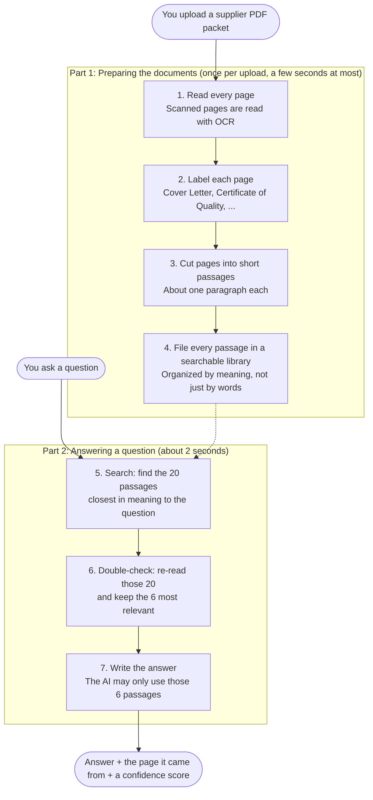

# SDF Document Assistant

A Retrieval-Augmented Generation (RAG) chatbot for **pharmaceutical supplier documentation
(SDF) packets**. Upload a PDF packet, ask questions in plain English, and get answers that come
only from the documents, with the source document and page cited for every fact.

Built as the final project of an Extern externship.

## What it does

An SDF packet is one PDF that bundles several documents: a cover letter, Certificates of
Quality, a BSE/TSE (animal origin) declaration, packaging specifications, sterilization
certificates and more. Some pages are digital text, some are scans. The assistant:

- reads every page, using OCR for scanned pages;
- works out which document each page belongs to;
- answers questions such as *"What are the lot numbers and expiry dates?"* or
  *"Who signed the cover letter?"*, citing e.g. *(Certificate of Quality, Page 3)*;
- says *"The documents don't contain this information"* instead of guessing.

## System architecture

The assistant works in two parts. **Part 1** prepares the documents once, when a PDF is
uploaded. **Part 2** runs every time someone asks a question.



**What each step does, in plain English**

1. **Read every page.** The assistant pulls the text out of each page of the PDF. Some pages are
   scans (pictures of paper), so for those it uses OCR, which recognizes the letters in an image,
   the way a phone app reads a photographed receipt.
2. **Label each page.** One PDF holds several documents. The assistant works out which one each
   page belongs to (cover letter, certificate of quality, animal-origin declaration, packaging
   specification and so on), mostly from the page's title. If it is unsure, it asks the AI.
   Every answer can then say exactly where it came from.
3. **Cut pages into short passages.** A whole page is too much to search at once, so each page is
   split into passages of about a paragraph. A passage never runs across two pages, so every fact
   keeps a single page number.
4. **File every passage in a searchable library.** Each passage is stored with a "meaning
   fingerprint": a list of numbers that captures what the passage is about. Passages about the
   same topic get similar fingerprints, so "expiry date" can find "use before" even though the
   words differ.
5. **Search.** When you ask a question, it gets a fingerprint too, and the 20 closest passages are
   pulled out. If the question names a document ("the cover letter"), half of them come from
   that document.
6. **Double-check.** A second, more careful model reads the question next to each of the 20
   passages and keeps the 6 that answer it best, like a librarian checking a stack of books
   before handing them over.
7. **Write the answer.** The AI model (GPT-6 Luna) writes a short answer **using only those 6
   passages**, with the page each fact came from, such as *(Certificate of Quality, Page 3)*. If
   the passages don't contain the answer, it says *"The documents don't contain this
   information"* instead of guessing.

**What you see:** the answer, a list of sources (document, page and file), a confidence score
showing how closely the passages matched the question, and how long it took.

### Technical details

| Step | File | How |
|---|---|---|
| Read | `src/ingest.py` | PyMuPDF text extraction; pages with almost no text are rendered at 300 DPI and read with Tesseract OCR |
| Label | `src/classify.py` | Keyword rules (title words count double) assign a document type; when unsure, the LLM labels the page |
| Chunk | `src/chunking.py` | Each page becomes a LlamaIndex `Document`; `SentenceSplitter` makes 200-token nodes that never cross a page |
| Index | `src/index.py` | LlamaIndex `VectorStoreIndex` on FAISS, embedded with `BAAI/bge-small-en-v1.5`; each chunk is embedded with its document type |
| Retrieve | `src/index.py` | If a question names a document type, half the candidates come from that type and half are the best matches overall |
| Rerank | `src/index.py` | A cross-encoder (`ms-marco-MiniLM-L-6-v2`) re-scores the top 20 candidates and keeps the best 6 |
| Answer | `src/rag.py` | LlamaIndex response synthesizer with a grounded prompt (cite sources, list every batch, never answer from the wrong document) |
| UI | `app.py` | Gradio app: upload, document summary, chat with sources, confidence score and response time |

## Results

`src/evaluate.py` runs 19 questions with known answers on three SDF packets (including one from
a different supplier, with different wording) and checks both the answer and the retrieved
document:

- **Answers correct: 19/19**
- **Right document retrieved: 15/15** (the other 4 are off-topic or missing-document questions)
- **Retrieval:** hit rate 100%, MRR 0.97 (0.82 before adding the reranker), Recall@6 95.6%

Full table: [`eval_results.md`](eval_results.md).

## Tech stack

Python · LlamaIndex · FAISS · sentence-transformers (`BAAI/bge-small-en-v1.5`) ·
PyMuPDF · Tesseract OCR · OpenAI API (GPT-6 Luna) · Gradio

## Run it locally

Requirements: Python 3.10+ and [Tesseract](https://github.com/tesseract-ocr/tesseract)
(macOS: `brew install tesseract`).

```bash
git clone <this repository>
cd <repository folder>
python3 -m venv .venv
source .venv/bin/activate
pip install -r requirements.txt
cp .env.example .env      # then put your OpenAI API key in .env
python app.py             # open the URL it prints, usually http://127.0.0.1:7860
```

Upload a PDF from `data/`, click **Process**, then ask a question or click an example.

Other commands:

```bash
python src/evaluate.py    # score the pipeline on the sample packets
python src/rag.py         # question/answer test on the sample PDF in the terminal
```

## Project structure

```
app.py                    Gradio UI
src/
  config.py               settings and model registry (keys come from .env)
  ingest.py               PDF -> pages (with OCR fallback)
  classify.py             page -> document type
  chunking.py             pages -> LlamaIndex nodes
  index.py                vector index + retrieval with soft routing
  llm.py                  LLM access through LlamaIndex (OpenAI-compatible)
  rag.py                  question -> answer with sources and confidence
  evaluate.py             automatic evaluation
data/                     sample SDF packets + eval_questions.json
```

## Limitations and next steps

- Tested on three packets; every new supplier packet should be added to the evaluation set.
- The confidence score measures how well retrieval matched, not whether the answer is correct.
- Next: keyword (BM25) search alongside vector search for exact codes, an open-source model
  option (gpt-oss-20b on Groq), and a saved index for large document sets.
